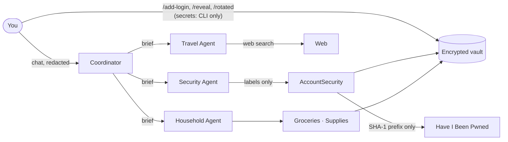

# Agentic Prototype for an Encrypted Personal Assistant That Minimizes the Risk of Big Data Profiling

[](https://github.com/emitby/Agentic-Prototype-for-an-Encrypted-Personal-Assistant-That-Minimizes-the-Risk-of-Big-Data-Profiling/actions/workflows/ci.yml)


[](LICENSE)

A multi-agent personal assistant built on Claude. It keeps every stored item encrypted and keeps your secrets out of everything sent to the AI. The design question it explores: **how much can an AI assistant do for you while sending as little as possible about you to anyone else?**

→ [Threat model](docs/threat-model.md) · [Architecture](docs/architecture.md) · [Example session](docs/example-session.md) · [Security policy](SECURITY.md)

> **Status: research prototype.** It's useful for exploring privacy-preserving agent design. Don't make it your only password manager.

| Area | What it does |
|---|---|
| **Account security** | Checks your saved passwords against Have I Been Pwned without sending them anywhere. Finds weak and reused passwords, checks your email addresses for breaches, and guides password rotation. |
| **Travel** | Searches the web for flights and compares fares, with sources. |
| **Household** | Keeps grocery lists, and tracks supplies like laundry detergent, estimating when you'll run out from how fast you actually use them. |

## Agents



| Agent | Tools | Effort |
|---|---|---|
| **Coordinator** | Delegates to the three specialists, in parallel when a request spans areas | medium |
| **Security Agent** | `list_accounts`, `check_password_breaches`, `check_email_breaches`, `start_password_rotation` | low |
| **Travel Agent** | Claude web search (server tool), `get_travel_preferences`, `set_home_airport` | medium |
| **Household Agent** | `show_grocery_lists`, `add_grocery_items`, `check_off_grocery_items`, `remove_grocery_items`, `track_supply`, `log_supply_reading`, `estimate_supplies` | low |

Each specialist starts every task with a fresh context and gets only the tools for its area, so data from one area never sits in another agent's context.

## Privacy and security design

### At rest: everything is encrypted

- The whole store is in one file (`~/.personal-assistant/vault.enc` by default): accounts, email addresses, grocery lists, supply readings, travel preferences and the chat transcript.
- **AES-256-GCM** with a fresh random nonce on every save. Any change to the file is detected and rejected.
- The key comes from your passphrase via **scrypt** (N=2¹⁷, about 128 MiB). It isn't stored anywhere, and the passphrase can't be recovered.
- Writes are atomic, so a crash can't leave a half-written vault.

### In transit: secrets never reach the AI

- **Passwords, stored email addresses and usernames are never sent to Claude.** Tools refer to accounts by label (`github`), and their outputs leave out all secrets.
- **Outbound filter.** Every message, brief and tool result passes through a redactor before it goes to the API. Stored secrets become `[password:github]` or `[email:personal]`. Any other email address becomes `[email]`, and any number that passes the card checksum becomes `[card]`. If you paste a password into the chat, it's removed before Claude sees it, and the CLI tells you.
- **Human-only actions.** Adding logins, revealing passwords and confirming rotations are terminal commands. No agent has these tools.
- **Breach checks use k-anonymity.** Only the first 5 hex characters of a password's SHA-1 hash go to Have I Been Pwned, with response padding enabled. The password and full hash never leave your machine.

### What this does *not* protect

"Profiling is impossible" isn't a claim any app that uses cloud AI or web search can honestly make. Here is exactly what leaves your machine:

| Data | Goes to | Why |
|---|---|---|
| Your chat messages, after redaction | Anthropic (Claude API) | The model has to read a request to act on it. Grocery items, travel plans and supply levels you mention are visible to it. |
| Flight search queries (route, dates) | Anthropic's web search and the sites it reads | Searching requires saying what you're searching for. |
| 5-character password hash prefixes | Have I Been Pwned | Shared by hundreds of passwords, so they reveal nothing about yours. |
| Email addresses, only when you ask for an email breach check | Have I Been Pwned | HIBP has to know the address to look it up. |
| Your IP address and request timing | All of the above | Use a VPN or Tor if that matters to you. |

To reduce this further, keep chats to the task, use an Anthropic organization with zero data retention, and run breach checks only when needed.

## Why password changes aren't automatic

Websites have no standard API for changing a password. Scripting each site's login page breaks on 2FA, CAPTCHAs and redesigns, can lock you out of your own accounts, and would require giving an AI agent the ability to change your credentials. So rotation is **assisted**:

1. The agent generates a 20-character random password and stages it in the vault. The agent never sees it.
2. It gives you the site's change-password page, using the W3C [`/.well-known/change-password`](https://w3c.github.io/webappsec-change-password-url/) URL.
3. You run `/reveal github --new`, change the password on the site, then run `/rotated github`.

## How supply estimates work

Supplies are tracked in a unit you choose, such as loads or fl oz. You log readings: a **restock** (the amount on hand after buying) or a **level** (the amount left now).

- **Daily use** is learned from the drop between consecutive readings. Restock intervals are skipped, since their usage is unknown. Until you have two readings, a configured rate is used, e.g. 4 loads a week = 0.571 a day.
- **Remaining now** = last reading − daily use × days since then.
- From that it reports days left, the run-out date, a **reorder-by** date (run-out minus lead time) and whether there's enough for the next week.

All of this is plain Python in [`household.py`](assistant/household.py), so the model reports these numbers but never computes them.

## Setup

Requires Python 3.10+ and an [Anthropic API key](https://console.anthropic.com/).

```bash
git clone https://github.com/emitby/Agentic-Prototype-for-an-Encrypted-Personal-Assistant-That-Minimizes-the-Risk-of-Big-Data-Profiling.git personal-assistant
cd personal-assistant

python -m venv .venv
.venv\Scripts\activate             # macOS/Linux: source .venv/bin/activate
pip install -r requirements.txt

set ANTHROPIC_API_KEY=sk-ant-...   # macOS/Linux: export ANTHROPIC_API_KEY=sk-ant-...

python -m assistant.cli --init     # first time: create the vault and choose a passphrase
python -m assistant.cli --verbose  # later: unlock and chat
```

**Your passphrase can't be recovered.** Without it, the vault can't be decrypted.

Optional: a [Have I Been Pwned API key](https://haveibeenpwned.com/API/Key) (paid) enables email breach checks. Password checks are free and need no key.

## Usage

```
you> /add-email personal
you> /add-login github          # site, username, hidden password, linked email
you> check my passwords for breaches
you> /reveal github --new       # during a rotation
you> /rotated github
you> add eggs, oat milk and coffee to groceries
you> I just bought detergent, 64 loads. We do about 5 loads a week.
you> how much detergent is left?
you> find flights from JFK to Lisbon May 14-21, nonstop if possible
```

| Command | Purpose |
|---|---|
| `/add-email <label>` | Store an email address |
| `/add-login <label>` | Store a website login (password typed hidden) |
| `/set-hibp-key` | Store an HIBP API key (typed hidden) |
| `/accounts` | List accounts and their breach status |
| `/reveal <label> [--new]` | Show a stored password, or the staged one with `--new` |
| `/rotated <label>` | Confirm you changed the password on the site |
| `/quit` | Lock the vault and exit |

## Tests

```bash
pytest
```

The 22 tests make no network or API calls. They use a mock HIBP server and a scripted Claude client.

- **Vault:** round-trip, nothing readable on disk, wrong passphrase, tamper detection, KDF parameters bound to the ciphertext, fresh nonces
- **Privacy:** the redactor handles stored secrets, other email addresses and card numbers. An end-to-end test checks that **no password, email, username or staged password appears in anything sent to the model**, or in the stored transcript.
- **Security:** k-anonymity requests and padding, reuse and weakness detection, the rotation flow, email checks with and without a key
- **Household:** list lifecycle, configured and learned usage rates, restock handling, reorder alerts, validation
- **Agents:** fresh specialist contexts, least-privilege tool sets, parallel delegation, web-search `pause_turn` continuation, tool errors returned to the model

## Project layout

```
assistant/
├── vault.py          AES-256-GCM + scrypt encrypted store
├── privacy.py        Outbound redactor
├── security.py       HIBP client, credential store, rotation
├── household.py      Grocery lists, supply tracking and estimates
├── agents/
│   ├── runtime.py    Agent loop (server tools, pause_turn, redaction)
│   └── team.py       Coordinator and the three specialists
└── cli.py            Terminal interface
docs/
├── threat-model.md   Assets, adversaries, mitigations, residual risks
├── architecture.md   Layers, sequence diagram, agent loop, vault format
└── example-session.md  A real run, with every number checked
tests/                Vault, privacy, security, household and agent tests
SECURITY.md           How to report vulnerabilities
CONTRIBUTING.md       Ground rules for privacy-preserving changes
```

## Model

All agents use `claude-opus-5-5` with adaptive thinking and server-side refusal fallbacks (`fallbacks="default"`). The Travel Agent uses the `web_search_20260209` server tool with up to 10 searches per task.

## Roadmap

- [ ] Local model option for household tasks, so grocery and supply data never leaves the machine
- [ ] Pseudonymized travel queries (e.g. strip exact dates until booking intent is confirmed)
- [ ] Auto-lock after inactivity, and clipboard copy with auto-clear for `/reveal`
- [ ] Import from password-manager exports (Bitwarden, 1Password CSV)
- [ ] Scheduled breach monitoring with local notifications

## License

[MIT](LICENSE) © 2026 Edward Mitby
