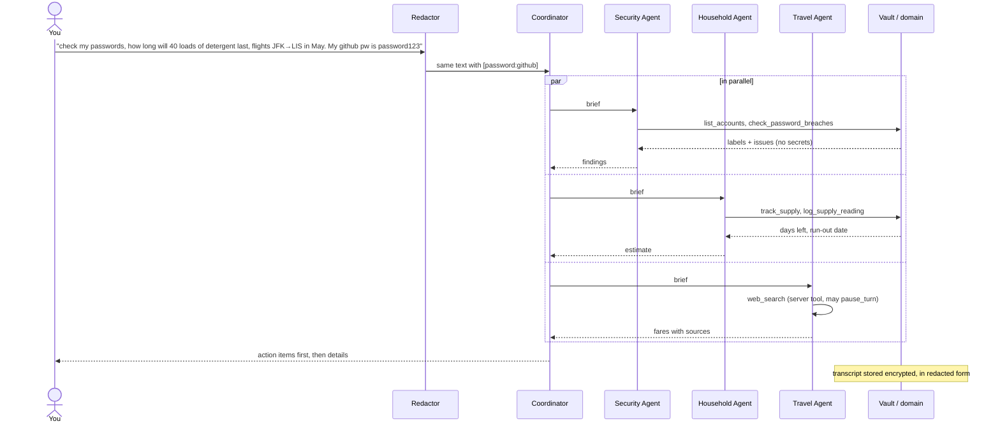

# Architecture

## Layers

| Layer | Module | Responsibility |
|---|---|---|
| Storage | [`vault.py`](../assistant/vault.py) | Encrypted JSON store (AES-256-GCM + scrypt) |
| Privacy | [`privacy.py`](../assistant/privacy.py) | Outbound redaction of secrets and identifiers |
| Domain | [`security.py`](../assistant/security.py), [`household.py`](../assistant/household.py) | Breach checks, rotation, grocery lists, supply estimates. **No AI.** |
| Agent runtime | [`agents/runtime.py`](../assistant/agents/runtime.py) | Claude tool-use loop with server tools, `pause_turn` and redaction |
| Agent team | [`agents/team.py`](../assistant/agents/team.py) | Prompts, tool wiring, delegation |
| Interface | [`cli.py`](../assistant/cli.py) | Chat, plus human-only secret commands |

The domain layer is deterministic Python with its own tests. The agents choose which operations to run, and the code decides what those operations return.

## A multi-area request



## Agent loop

`Agent.run(messages)`:

1. Run the **pre_model hooks**: the token budget check (G6) and the **outbound scan** (G4), which refuses to send a request that still contains a stored secret. Then call `client.beta.messages.create` with the agent's prompt, tools (custom and server), effort, prompt caching and server-side fallbacks. Then run the **post_model hooks** (budget charge) and emit a `model_call` event with the usage.
2. Append the full assistant `content` to the history. The history is never edited.
3. `refusal` returns a safe reply. `pause_turn` (a long server-side web search) loops again to let it finish. With no tool calls, return the text.
4. Run the custom tool calls concurrently. For each call:
   - Unknown tools are refused.
   - The **pre_tool hooks** run: schema (G2), path guard (G8), call limit (G7). A block becomes an `is_error` result naming the reason.
   - The handler runs. Domain errors become `is_error` results; unexpected exceptions are logged and returned as generic errors.
5. Run the **post_tool hooks** on every result: leak detector (G5), redaction (G4), size cap (G7). Then append all results in one user message.
6. Stop after `max_turns`.

See [hooks.md](hooks.md) for the hook pipeline and [harness.md](harness.md) for the events.

## Delegation

Specialists are tools whose handlers run another `Agent` on a one-message conversation:

```python
Tool("ask_security_agent", ..., lambda brief: self._delegate(self.security_agent, brief))
```

`_delegate` redacts the brief, too. Each specialist:

- starts with a **fresh context**, so no other area's data is present
- gets **only its own tools**, so the Travel Agent, which reads untrusted web pages, can't touch credentials
- runs at the **lowest effort that does the job**: `low` for Security and Household, `medium` for Travel

## Vault format

```json
{
  "v": 1,
  "kdf":   {"salt": "<b64 16 bytes>", "n": 131072, "r": 8, "p": 1},
  "nonce": "<b64 12 bytes>",
  "ct":    "<b64 AES-256-GCM(ciphertext || tag)>"
}
```

- Key: `scrypt(passphrase, salt, n, r, p) → 32 bytes`
- Associated data: `{"v", "kdf"}`, canonical JSON
- Plaintext: one JSON document with the sections `credentials`, `emails`, `grocery_lists`, `supplies`, `travel`, `transcript` and `settings`
- Saves write to `vault.tmp`, then `Path.replace` it over the vault, which is atomic
- Salt and nonces come from `secrets.token_bytes`
- The vault path must resolve inside the project directory (default `data/vault.enc`). Anything else raises `VaultError`, so the app never writes outside its own folder.

## Supply estimation

Readings are `{date, kind: "restock" | "level", amount}`:

```
daily_use = Σ max(prev - cur, 0) / Σ days     over consecutive pairs where cur is a "level" reading
            (falls back to configured_daily_use until such a pair exists)
remaining = last.amount - daily_use × days_since(last)
days_left = remaining / daily_use
reorder_by = today + days_left - reorder_lead_days
```

Restock intervals are skipped because the amount used before the restock is unknown.
